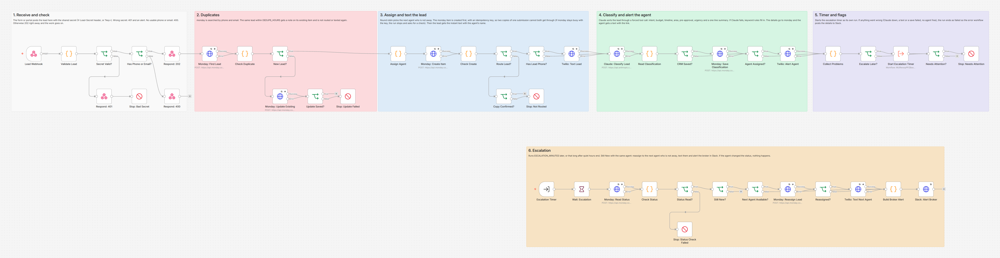
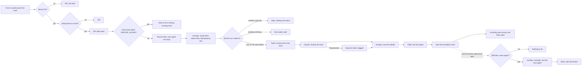

# Real Estate Speed-to-Lead Router: Claude + monday.com + Twilio

A new real estate lead gets a text within seconds, the right agent gets the lead with an AI summary, and if nobody picks it up in a few minutes it moves to the next agent and the broker hears about it. Built with n8n, Claude, monday.com and Twilio.



## The problem

A buyer who fills in a form on a listing often contacts more than one agent the same evening. The one who calls back first tends to get the showing. In most offices the lead lands in a shared inbox or a CRM, waits until someone notices it, and nobody knows who was supposed to call. When the assigned agent is busy, the lead just sits there.

## What this does

1. **Texts the lead within seconds**, with the name and number of the agent who will call them.
2. **Picks the agent by round robin** across your team, skipping anyone marked away.
3. **Saves the lead in monday.com** with status New, the agent, the source and the message.
4. **Sorts the lead with Claude**: buyer, seller, renter or investor, budget, timeline, area, pre-approval, urgency from 1 to 5 and a one line summary. If Claude is down, simple keyword rules fill in, so the lead is still routed (and flagged).
5. **Texts the agent** the summary, the lead's phone and email, and the monday link.
6. **Escalates.** If the status is still New after `ESCALATION_MINUTES`, the lead moves to the next available agent, who gets a text, and the broker gets a Slack alert. If the agent changed the status, nothing happens.
7. **Recognizes repeats.** The same phone or email within `DEDUPE_HOURS` adds a note to the existing monday item instead of routing the lead again.
8. **Fails safely.** Requests without the shared secret are refused. Every API call is retried, and anything that went wrong (a failed text, a failed save, Claude down, nobody available) is posted to Slack through the error workflow. Problems are reported at the end of the run, so an alert never delays the first text.

## How it works



The webhook answers 202 before any API is called, so a form or portal never waits or retries. The lead's text goes out before Claude is asked anything: speed comes first, and the AI details follow a second or two later.

The escalation runs as its own execution. The intake run starts it in the background (the workflow calls itself), and it waits on a Wait node. Waits longer than a minute are parked in n8n's database, so they survive a restart and do not hold a worker.

## Workflow at a glance

| Step | Nodes | What it does |
|---|---|---|
| 1 | Lead Webhook | Receives the lead (POST, JSON or form) |
| 2 | Validate Lead, Secret Valid?, Respond: 401, Stop: Bad Secret | Checks `X-Lead-Secret` (or `?key=`) in constant time. With no secret configured, everything is refused. A refused call raises an alert |
| 3 | Has Phone or Email?, Respond: 400, Respond: 202 | Normalizes the phone to E.164 and the email to lowercase. 400 when neither is usable, otherwise 202 at once |
| 4 | Monday: Find Lead, Check Duplicate, New Lead? | One GraphQL query searches by phone and by email. Matches within `DEDUPE_HOURS` are compared exactly, because monday's phone search also matches partial numbers |
| 5 | Monday: Update Existing, Update Saved?, Stop: Update Failed | A repeat gets a note on the existing item (and the phone or email it was missing). No routing, no texts |
| 6 | Assign Agent | Round robin over `AGENTS_JSON`, skipping away agents. Writes the lead's text and works out when to check back, including quiet hours |
| 7 | Monday: Create Item, Check Create, Route Lead?, Copy Confirmed?, Stop: Not Routed | Creates the item with an `Idempotency-Key`, so two copies of one submission make one item and only one of them goes on. If monday still reports the key as busy after every retry, the run stops at Stop: Not Routed with the lead's details instead of ending quietly. Moves the round robin pointer only when this run routes the lead |
| 8 | Has Lead Phone?, Twilio: Text Lead | The instant text to the lead |
| 9 | Claude: Classify Lead, Read Classification | Forced tool call `classify_lead` at low effort, so the agent's text is not held up. Keyword rules when Claude fails after 3 tries or answers without the tool |
| 10 | CRM Saved?, Monday: Save Classification | Writes Claude's details to the item, plus a note when a person needs to step in |
| 11 | Agent Assigned?, Twilio: Alert Agent | Texts the agent the summary and the monday link |
| 12 | Collect Problems, Escalate Later?, Start Escalation Timer, Needs Attention?, Stop: Needs Attention | Starts the escalation run. Gathers every problem in this run and, if there are any, ends it as failed so the error workflow posts them |
| 13 | Escalation Timer, Wait: Escalation | The background run waits until the check time |
| 14 | Monday: Read Status, Check Status, Status Read?, Stop: Status Check Failed, Still New? | Reads the status and the agent again. Anything other than New with the same agent ends the run here |
| 15 | Next Agent Available?, Monday: Reassign Lead, Reassigned?, Twilio: Text Next Agent | Moves the lead to the next agent who is not away, adds a note to the item and texts them |
| 16 | Build Broker Alert, Slack: Alert Broker | Tells the broker what happened, with Slack mentions |

## What everyone gets

From the test run (all data made up; the timer was 9 seconds in the test and is shown here at the default 5 minutes).

**The lead**, a few seconds after sending the form:

```
Hi Jamie, thanks for reaching out to Acme Realty! Maya Chen will call or text you in the next few minutes. You can also reach Maya directly at (512) 555-0101. Reply STOP to opt out.
```

**The agent:**

```
New lead for you: Jamie Rivera
Buyer, urgency 5/5
Budget: $480k
Timeline: ASAP
Area: East Austin
Pre-approved: Yes
"Pre-approved buyer, $480k, wants a 3 bed & 2 bath in East Austin and can tour this weekend."
Phone: (512) 555-0142
Email: jamie.rivera@example.com
Source: Website
Open in monday: https://example-realty.monday.com/boards/5551234567/pulses/9100000001
Update the status in monday within 5 min, or the lead goes to the next agent.
```

**The broker in Slack**, when nobody changed the status in time (as Slack shows it, with the mentions resolved):

```
@Broker :warning: Lead not picked up within 5 minutes
Jamie Rivera: Buyer, urgency 5/5, from Website
> Pre-approved buyer, $480k, wants a 3 bed & 2 bath in East Austin and can tour this weekend.
Moved from Maya Chen @Maya to Leo Park @Leo, who was just texted.
Open in monday: https://example-realty.monday.com/boards/5551234567/pulses/9100000001
```

**The monday item** gets the phone, email, status New, agent, source and message right away, then intent, budget, timeline, area, pre-approval, urgency, summary and who classified it (Claude or the keyword rules).

## Quiet hours

By default, quiet hours are 21:00 to 08:00 in `TIMEZONE`. **The lead is still texted right away**, because they asked to be contacted seconds ago, and a reply to that request is what they expect. Only the wording changes: the agent "will get back to you first thing in the morning". The agent alert also goes out at once (agents can silence their own phones), with a deadline in local time, and the escalation check waits until quiet hours end plus `ESCALATION_MINUTES`, so nobody is reassigned a lead at 2 AM.

This is a product choice, not legal advice. In the US, the federal TCPA and several state laws limit telephone solicitations (texts included) at night in the recipient's time zone, and the quiet hours here use the office's time zone, not the lead's. If your compliance advisor wants the first text held until morning, that is a small change in the Assign Agent node. Set `QUIET_HOURS=off` to turn quiet hours off.

## Setup

**You need:** self-hosted n8n reachable over HTTPS, a monday.com board, a Twilio number that can send SMS (registered for A2P 10DLC if you text US numbers), an Anthropic API key and, optionally, a Slack incoming webhook. Step by step, including a one step way to create the board columns: [docs/setup.md](docs/setup.md).

1. Import `workflow/error-alert-slack.json` and **activate it** (n8n 2.x skips error workflows that are not active).
2. Import `workflow/real-estate-speed-to-lead.json` and choose the error alert workflow as its **Error Workflow** in the workflow settings.
3. Add the variables below to your n8n environment and restart n8n. The nodes read them with `$env`, so self-hosted n8n needs `N8N_BLOCK_ENV_ACCESS_IN_NODE=false`. (n8n Cloud does not allow `$env`. There, replace `$env.` with `$vars.` and create the same names under Variables.)
4. Activate the workflow and point your form or portal at `https://YOUR-N8N-DOMAIN/webhook/real-estate-lead` with the `X-Lead-Secret` header.

| Variable | Required | Where to find it |
|---|---|---|
| `LEAD_WEBHOOK_SECRET` | yes | Any long random string you make up. Your form sends it in the `X-Lead-Secret` header (or as `?key=`) |
| `ANTHROPIC_API_KEY` | yes | console.anthropic.com → API keys |
| `ANTHROPIC_MODEL` | no | Default `claude-sonnet-5`. `claude-haiku-4-5` (cheaper) and `claude-opus-5` also work. Not `claude-opus-5-5` or `claude-fable-5-1`: they refuse the forced tool call |
| `MONDAY_API_TOKEN` | yes | monday.com → profile picture → Developers → My access tokens |
| `MONDAY_BOARD_ID` | yes | The number in the board URL |
| `MONDAY_API_VERSION` | no | Default `2026-07`, monday's current stable version |
| `MONDAY_GROUP_ID` | no | The group new leads go into. Empty means the top group |
| `MONDAY_COLUMNS` | no | JSON map of column IDs, only if yours differ from the defaults in [docs/setup.md](docs/setup.md) |
| `TWILIO_ACCOUNT_SID`, `TWILIO_AUTH_TOKEN` | yes | console.twilio.com → Account Info |
| `TWILIO_FROM_NUMBER` | one of these two | Your Twilio number in E.164, for example `+15125550100` |
| `TWILIO_MESSAGING_SERVICE_SID` | one of these two | Messaging → Services (starts with `MG`). Wins over the From number when both are set |
| `AGENTS_JSON` | yes | The agents in round robin order: `[{"name": "...", "phone": "+1...", "slack": "U...", "email": "...", "away": false}]` |
| `SLACK_WEBHOOK_URL` | no | A Slack incoming webhook for broker alerts and error alerts. Empty skips Slack |
| `BROKER_SLACK_ID` | no | The broker's Slack member ID (profile → three dots → Copy member ID), for the mention |
| `BUSINESS_NAME` | no | The name in the lead's text (default "our team") |
| `DEDUPE_HOURS` | no | Default `72`, minimum `1` |
| `ESCALATION_MINUTES` | no | Default `5`. Decimals work, which is how the test uses a 9 second timer (minimum `0.05`) |
| `QUIET_HOURS` | no | Default `21:00-08:00`. Empty or `off` turns them off |
| `TIMEZONE` | no | IANA name, default `America/New_York` |
| `DEFAULT_COUNTRY` | no | Country for numbers written without a country code, default `US`. +1 numbers are saved with the right country (US, Canada, Puerto Rico and so on) by area code, because monday refuses a number that does not match its country |

## Testing

The workflow was tested end to end on n8n 2.19.5 against **mock monday.com, Twilio, Claude and Slack APIs**, so no real board, phone number or Slack workspace was touched. The mocks are strict, so a pass means something:

- The mock monday API validates every query and mutation against a GraphQL schema written from monday's API reference, checks column values the way monday does (a phone needs a country it belongs to, a status label must exist unless the request allows creating it, unknown column IDs fail), returns errors with HTTP 200 like the real API, and honours the `Idempotency-Key` header (a repeat gets the cached response with `Idempotency-Replayed: true`, a repeat while the first is still running gets a 409). One request monday would reject anywhere in the run fails the test.
- The mock Twilio API wants basic auth, a form encoded body, E.164 numbers and a From number or Messaging Service, and answers with Twilio's error codes.
- The mock Claude returns scripted tool calls, but rejects requests the real Messages API would reject (unknown fields, an effort setting on Haiku, a tool that is not forced). The real request was also checked against Anthropic's free token counting endpoint, which validates the system prompt, the tool schema, the forced tool choice and the effort setting without generating anything.
- Every error alert is matched to its run by the execution link inside it, and "nothing else ran" is checked from the nodes each run executed, not from the executions list (which leaves out runs n8n still has waiting).

All 62 checks pass: 32 scenarios, plus three checks over every monday, Twilio and Claude request the run made.

| Scenario | Result |
|---|---|
| Forged request, no secret / wrong secret | 401, nothing called, one alert per refused run posted by the error workflow |
| `LEAD_WEBHOOK_SECRET` left empty | Every request refused, even one with an empty `?key=` |
| No valid phone or email | 400, monday never called |
| New lead from the website form | 202 at once, one item with every column, the lead texted before Claude is called, Claude asked at low effort without the name, phone or email, Claude's details saved, agent texted with the link |
| Nobody changes the status | Status read again after the timer, lead moved to the next agent (skipping the one who is away), note on the item, next agent texted, broker alerted in Slack |
| Portal lead with nested JSON and a dotted phone number | Fields found, phone normalized, next agent in turn |
| Agent changes the status in time | Escalation reads the status and stops |
| Agent reassigned by hand | Escalation does nothing |
| Same lead within `DEDUPE_HOURS` | Note on the existing item, no new item, no texts, no Claude call, no timer |
| Email only lead, form post, secret in the URL | Routed, the agent is told it is email only |
| Same lead again by email, now with a phone | The phone is added to the existing item, no new routing |
| Same submission twice at the same moment | One item, one text to the lead, one to the agent |
| monday search down while the same lead is sent again | The idempotency key still stops a second item and second texts |
| monday still busy with the same key on every try (409) | No texts and no Claude call, and the run stops at Stop: Not Routed with the lead's details instead of ending quietly |
| Claude down (529, 3 tries) | Keyword rules classify it, everything else still happens, run flagged |
| Claude answers without the tool (a refusal) | Not retried, keyword rules classify it, the lead and the agent are still texted, run flagged with the stop reason |
| Lead opted out of texts (Twilio 21610) | The agent is told to call, a note goes on the item, run flagged |
| The agent's text is refused | The lead is still texted, the run is flagged so the broker can pass the lead on |
| Phone that cannot be read, but a valid email | Routed by email, nobody texts the lead, the run names the number that could not be read |
| Canadian number at a US office | Saved with country CA, which monday's number check accepts |
| monday down when the item is created | The lead and the agent are still texted, the agent is told to add it by hand, run flagged |
| monday answers 200 with an error | Not mistaken for success, run flagged with the monday error code |
| Escalation cannot read monday | Nothing reassigned, run flagged with the item link |
| Escalation cannot reassign in monday | The lead stays with the first agent, nobody else is texted, the broker is asked to move it by hand. The lead's `<!channel>` source shows as text and pings nobody |
| Next agent's text fails and Slack refuses the broker alert | Reassigned, the alert says the text failed, Slack tried 3 times, then the error workflow reports the failed run |
| monday down while a repeat is noted | Nothing routed or texted, run flagged with the item link |
| Round robin over fourteen leads | Maya, Leo, Maya, Leo... The agent who is away never gets one, repeats and unrouted leads do not move the pointer |
| Every monday, Twilio and Claude request in the run | Accepted by the strict mocks (apart from the failures the test caused on purpose) |
| Quiet hours | Lead texted at once with a morning promise, agent told the deadline in local time, the escalation parked in n8n's database until quiet hours end |
| Quiet hours, long wait | n8n resumes the parked run; nobody else is free, so the broker is asked to follow up |
| Everyone away, custom column IDs, UK number, Messaging Service | Office text to the lead, item Unassigned in the mapped columns, run flagged |
| `AGENTS_JSON` has a typo | Office text to the lead, item Unassigned, the flag names `AGENTS_JSON` |

Full output, the exact requests and the token count check: [docs/test-report.md](docs/test-report.md). Run the same test yourself with [tests/e2e_mock_test.py](tests/e2e_mock_test.py) (needs `pip install graphql-core`; takes about 5 minutes, most of it waiting for escalation timers). What testing and review found and fixed is in [CHANGELOG.md](CHANGELOG.md).

## What it handles when things go wrong

| Situation | What happens |
|---|---|
| Wrong or missing secret | 401, nothing else runs, alert in Slack. With `LEAD_WEBHOOK_SECRET` empty, every request is refused |
| Unreadable phone, but a valid email | The lead is routed by email, the agent is told, the run is flagged with the number that could not be read |
| Form or portal sends the same lead twice | Copies that arrive at the same moment: monday's idempotency key lets only one through. Later copies within `DEDUPE_HOURS`: a note on the existing item. An identical copy within 30 minutes is stopped by the idempotency key even when the duplicate search is down |
| monday still busy with the same submission after every retry (409) | The run does not route the lead (that could text it twice) and does not end quietly either: it stops at Stop: Not Routed, and the alert names the lead so someone can check the board |
| monday search fails | Retried 3 times, then the lead is treated as new: a missed lead costs more than a rare double text |
| monday save fails | Retried 3 times. The lead and the agent are still texted, the agent is told the lead is not in monday, the run is flagged with the details. No escalation timer, because there is no item to check |
| monday answers HTTP 200 with errors | Detected and flagged with monday's error code |
| Twilio refuses a text | Retried 3 times. A failed lead text means the agent is told to call, a note goes on the item and the run is flagged. A failed agent text is flagged so the broker can pass it on |
| Claude fails or skips the tool | An error is retried 3 times; an answer without the tool call (a refusal, or a cut off answer) is not retried. Either way keyword rules classify the lead, the item says "Rules (Claude unavailable)" and the run is flagged |
| Nobody available | The lead gets a text from the office, the item is Unassigned, the run is flagged |
| Escalation cannot read the status | Retried 3 times, nothing is reassigned, the run is flagged with the item link |
| Reassignment fails | The broker alert says it could not be reassigned and asks for a manual move |
| Next agent's text fails | The broker alert says so and asks them to call the agent |
| Slack refuses the broker alert | Retried 3 times, then the escalation run fails and the error workflow tries Slack again. The reassignment and the text to the next agent have already happened |
| The lead types Slack markup (for example `<!channel>` in a name or source) | Escaped the way Slack documents, so it shows as text and pings nobody |
| A Canadian or Puerto Rico number at a US office | Saved with its own country, because monday checks that a phone number belongs to the country it is saved with |

Every flagged run ends at a Stop and Error node, so the error alert workflow posts one Slack message with the full list of problems and a link to the run.

## Cost

Each new lead is one Claude call of about 1,330 input tokens (measured with Anthropic's token counter for `claude-sonnet-5`) and a short tool call back at low effort, well under one US cent at Sonnet 5 prices ($2 per million input tokens, $10 per million output). Repeats do not call Claude. On the Twilio side, a lead costs two texts (three when it is escalated). The agent text is several hundred characters, so it is billed as a few SMS segments.

## Limitations and next steps

- The round robin pointer lives in n8n's workflow static data. Two leads processed at the same moment can both go to the same agent, because n8n saves static data at the end of each run. At high volume, move the pointer to Redis, Postgres or an n8n data table.
- A lead escalates once. The second agent does not get a timer of their own; the broker's alert is the backstop.
- Twilio's Messages API has no idempotency key. If Twilio accepts a text but the answer times out, the retry can send the same text twice. This is rare, and the alternative (no retry) loses texts.
- monday's idempotency docs cover retries of the same request, not what happens when the key is reused with a slightly different body. Two copies of one submission differ only in the n8n run ID column, and the workflow relies on monday answering the second one with the first one's cached result (or a 409), as the docs describe for retries. The key also only lasts 30 minutes; after that, repeats are caught by the duplicate search.
- monday's email search matches the whole email label exactly. The workflow writes the email as the label, but if someone edits the label in monday, a repeat lead is only recognized by phone.
- Leads who reply to the text reach your Twilio number, not the agent. Forwarding replies to the assigned agent would be a natural next step.
- Quiet hours use the office time zone, not the lead's.
- API keys are read from environment variables. For production, move them into n8n credentials so they never appear in the workflow.
- The tests run against mocks written from the official API references. They cover the fields this workflow uses, not the whole APIs.

## About

Built by **Romiel Inolino**, AI and CRM Automation Specialist working with GoHighLevel, Monday.com, ClickUp, n8n, Make and Zapier.
Portfolio and case studies: [romielwillautomate.dev](https://romielwillautomate.dev)

This repository is a portfolio implementation. Credentials, API keys and customer data are not included, and all test data is made up.
